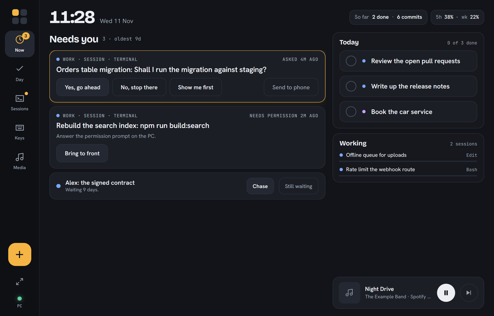

# Claude Deck

A web app for a tablet on your desk (and your phone) that shows every Claude Code session on your Windows PC, lights up the ones waiting on you, and lets you answer them with a tap.



A small Node server (the bridge) runs on the PC. It reads Claude Code's own session files and hook events, and drives the desktop through one PowerShell helper: bring a window to the front, paste a reply, press a chord, skip a track. The tablet pairs with it once over your LAN, or over Tailscale from anywhere.

I built it for my own desk. It is shared as-is: no support, no roadmap, no promise it works on your setup. Fork it and make it yours.

## What each tab does

- **Now.** One ranked list of what waits on you. A session whose last turn ended on a question or a permission prompt is a card with the answers as buttons (Yes, go ahead / No, stop there / Show me first, Send to phone). A waiting-on item on your day list that is five days old is a Chase card. Tap a card to see the session's last turns and type your own reply. On the right: today's picks, the sessions Claude is busy in, and a mini player. With nothing waiting it shows a calm clock face.
- **Day.** A day list kept in one markdown file you can also edit by hand or have Claude edit. Pick up to five items for Today from a shortlist; items carried three days ask you to keep, hand off or drop them. A Waiting on column shows who has what and for how long. "So far today" counts what you ticked and the commits you made.
- **Sessions.** Every Claude Code session on the PC with its state (needs you, working, tool waiting, finished, quiet), Claude's last words, a reply box for terminal sessions, Bring to front, Resume in a new terminal and Send to phone (Claude Code Remote Control).
- **Keys.** Prompt keys that paste text into the focused window or a chosen session, chord keys (Ctrl+Tab, Esc, Alt+K for dictation), seats that start a fresh Claude session in a folder with a brief, the phone push setup, and an app dock that focuses or opens your apps.
- **Media.** What is playing on the PC (Spotify, a browser tab), with artwork, transport and volume.
- **Jot** (the plus key on every screen). Type, paste a link, attach a photo or record a voice note. An idea becomes a dated note in a jots folder; a task goes on the day list. Afterwards the PC saves the link's text, has Claude describe the photo, and writes down the voice note, each appended to the note.

The header shows your Claude plan limits (five-hour and weekly), read from the status line and from `claude -p /usage`.

## Requirements

- Windows 10 or 11. The desktop control is PowerShell and Win32; nothing else is supported.
- Node.js 24.2 or newer (the server runs TypeScript directly through Node's type stripping).
- Claude Code installed and signed in, with `curl.exe` on the PATH (Windows ships it).
- A tablet or phone with a current browser, on the same network as the PC.
- Optional: [Tailscale](https://tailscale.com) on the PC and phone, for use away from home and for https (install as an app, voice notes, the share sheet).
- Optional: [ntfy](https://ntfy.sh) for phone push, either the public server or your own.
- Optional: [uv](https://docs.astral.sh/uv/) for voice note transcription (faster-whisper on the CPU, fetched on first use).

## Setup

1. Clone the repo and install: `npm ci`.
2. Copy `deck.config.example.jsonc` to `deck.config.jsonc` and edit it: your areas and the folders they cover, the day list path, the repos "So far today" counts, your apps, prompt keys and seats. Git ignores this file.
3. Copy `examples/list.md` to the day list path you chose, or let the deck create an empty one.
4. Build the tablet UI: `npm run build`.
5. Add the Claude Code hooks, which tell the deck the moment a turn ends or a permission prompt appears: `npm run hooks`. It backs up `~/.claude/settings.json` first and leaves your other hooks alone. `npm run unhooks` takes them out.
6. Point Claude Code's status line at the deck so it can read your plan limits. In `~/.claude/settings.json`:
   ```json
   "statusLine": { "type": "command", "command": "node C:/path/to/claude-deck/server/statusline.ts" }
   ```
   If you already have a status line, call `save()` from `server/statusline.ts` in yours instead.
7. Start the bridge: `npm start`. It prints the address to open on the tablet and a six-digit pairing code. Allow Node through Windows Firewall on private networks when asked. Open the address on the tablet and enter the code.
8. Run it at every login, hidden, restarted if it dies: `npm run install:task`. `npm run status` says whether it is up and shows the pairing code; `npm run uninstall:task` removes it.
9. Optional, for the phone: install Tailscale on the PC and the phone, then on the PC run `tailscale serve --bg --https=443 http://127.0.0.1:4771`. Open the https address on the phone, pair, and use Add to Home screen.
10. Optional, for push: `NTFY_URL=https://ntfy.sh bash ntfy/install.sh --pc-only` in Git Bash (or set `NTFY_HOST` and `NTFY_SSH` to run your own server; see the top of the script). Then subscribe from the ntfy box on the Keys screen and tap Send a test.

## Where things live

- `deck.config.jsonc`: your settings. The bridge reloads it on save.
- `~/.claude-deck/` (or `CLAUDE_DECK_HOME`): the pairing token, the log, the tap log (`npm run taps` lists which keys you never press), the push topic and the saved plan limits.
- `server/`: the bridge. `server.ts` is every route; `bridge.ts` wires in the real desktop; `win32.ps1` is the PowerShell helper.
- `ui/`: the React app the tablet loads.

## Things to know

- The bridge listens on your LAN. Every API call needs the paired token; the hook and health routes answer only connections from the PC itself. `npm start -- --new-token` unpairs every device.
- The deck types only into terminal sessions. A session in VS Code or Cursor gets Bring to front, because the deck cannot be sure which box in the editor has the cursor.
- Describing a photo runs Claude Code headless on Haiku, so it counts against your plan. Reading `/usage` does not make a model call.
- The ntfy topic name is the only secret on the push path. Anyone who learns it can send you a notification.
- `npm test` runs the server tests; `npm run typecheck` checks the server and UI types; `npm run dev` serves the UI with hot reload against a running bridge.

## License

MIT. See [LICENSE](LICENSE).
